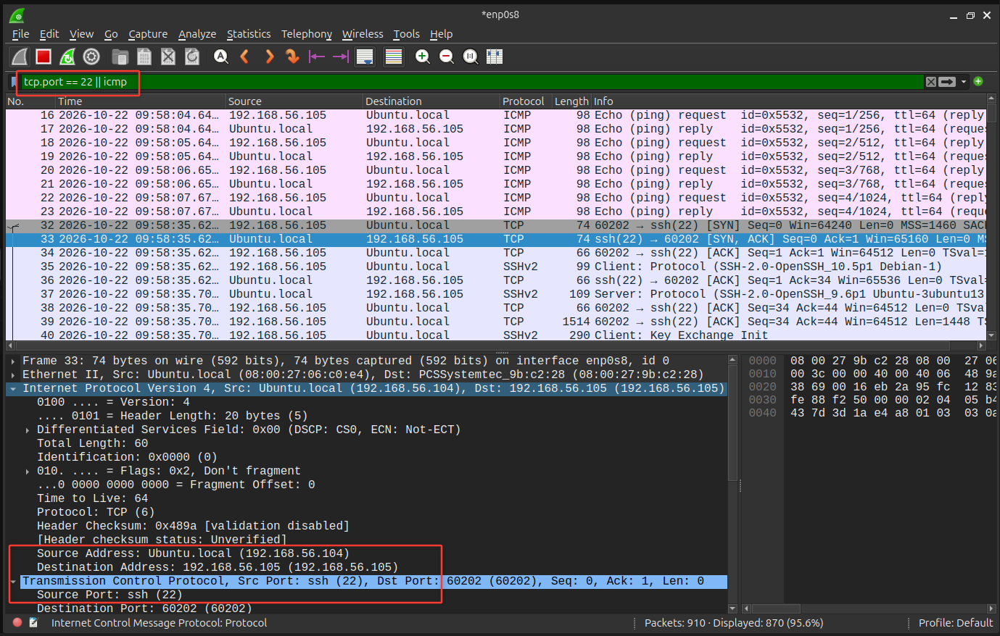
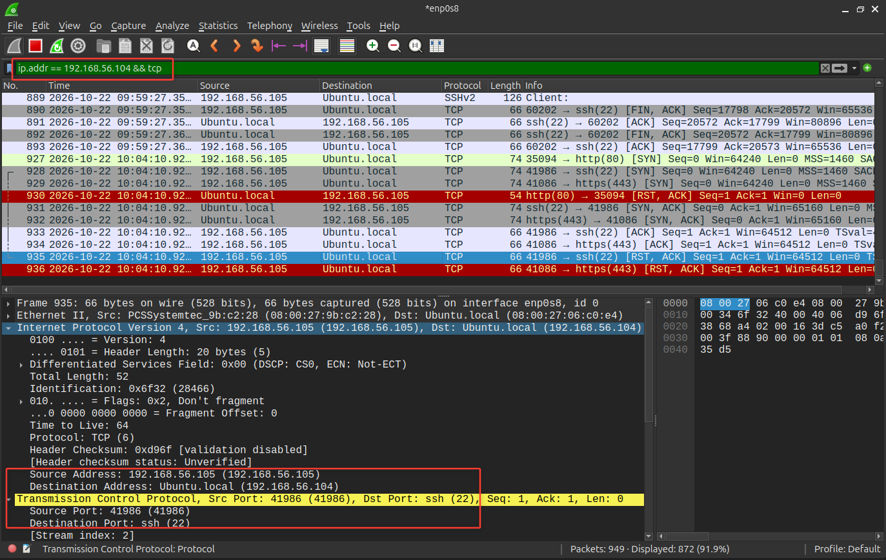
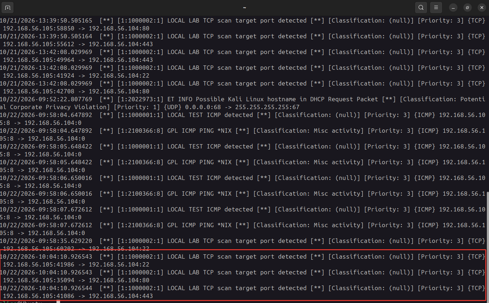
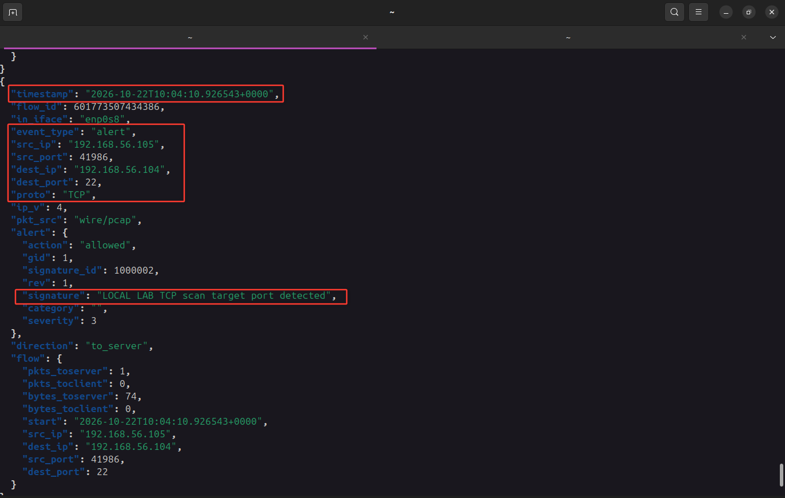

# Network Traffic & IDS Investigation

## Overview

This project demonstrates basic network traffic analysis and Intrusion Detection System (IDS) alert investigation using **Wireshark** and **Suricata** in a controlled virtual lab.

The objective was to capture normal network traffic, generate controlled port-scanning activity, identify suspicious packets, and correlate network evidence with Suricata alerts.

## Lab Environment

- **Kali Linux** — source of network traffic and port-scanning activity.
- **Ubuntu** — target system monitored by Suricata.
- **Wireshark** — packet capture and network traffic analysis.
- **Suricata** — network-based intrusion detection and alert logging.
- **Nmap** — controlled TCP port scanning.

## Investigation Workflow

### 1. Capture Normal Network Traffic

Generated normal network activity from Kali to Ubuntu:

- ICMP ping to test network connectivity.
- SSH connection to verify remote access.
- Packet capture using Wireshark.

**Wireshark display filter:**

```text
tcp.port == 22 || icmp
```

This filter displays packets associated with SSH traffic on TCP port 22 or ICMP traffic, allowing the analyst to inspect connectivity tests and remote access activity.

**Evidence:**



### 2. Generate and Analyze Suspicious Traffic

Executed a controlled TCP connect scan from Kali against the Ubuntu lab system:

```bash
nmap -sT -T3 -p 22,80,443 192.168.56.104
```

The scan tested TCP ports 22 (SSH), 80 (HTTP), and 443 (HTTPS).

Analyzed the resulting traffic in Wireshark using the following display filter:

```text
ip.addr == 192.168.56.104 && tcp
```

Selected a relevant packet to inspect the source IP address, destination IP address, TCP protocol, and destination port.

**Evidence:**



### 3. Identify the Suricata IDS Alert

Reviewed Suricata's fast alert log and located the entry corresponding to the port scan by comparing the alert timestamp with the time of the Nmap activity.

The `fast.log` entry provides a concise representation of a detected event, including available information such as the alert signature, classification, timestamp, source and destination addresses, and ports.

**Evidence:**



### 4. Investigate Alert Details in eve.json

Examined the corresponding alert event in Suricata's `eve.json` log.

The structured JSON event provides additional context for investigation, including available fields such as:

- `timestamp` — time of the event.
- `event_type` — event category, such as `alert`.
- `src_ip` and `dest_ip` — source and destination IP addresses.
- `src_port` and `dest_port` — source and destination ports.
- `alert.signature` — name of the triggered detection signature.
- `alert.category` — alert classification, when provided.
- `alert.severity` — severity value assigned by the rule.

The exact fields depend on the recorded event.

**Evidence:**



## Evidence Correlation

The investigation used two complementary sources of evidence:

- **Wireshark:** packet-level evidence showing the network communication and TCP traffic associated with the scan.
- **Suricata:** IDS alert records showing that the traffic matched a configured detection rule.

Correlating the packet capture with `fast.log` and `eve.json` helps establish whether the alert corresponds to the observed test activity.

## Analyst Assessment

The controlled port scan from Kali to Ubuntu generated TCP traffic that could be examined in Wireshark and investigated through Suricata's alert logs.

The packet capture provided network-level evidence of the activity, while the Suricata logs provided detection context through the triggered signature and associated event metadata. Comparing timestamps and network addresses helped correlate the observed traffic with the IDS alert.

From a SOC L1 perspective, the activity would be assessed as **suspected port scanning within an authorized lab environment**. In a production environment, an analyst would validate the source host, determine whether the scan was authorized, review the targeted services, and check for related activity or subsequent connection attempts.

An IDS alert indicates that traffic matched a detection rule; it does not independently establish malicious intent, successful exploitation, or system compromise.

## Conclusion

This project demonstrates a basic network investigation workflow:

1. Capture and identify normal network traffic.
2. Generate controlled suspicious activity.
3. Analyze relevant packets in Wireshark.
4. Locate the corresponding Suricata alert.
5. Correlate packet-level and IDS evidence.
6. Form an initial assessment and identify appropriate follow-up actions.

The exercise reinforces the importance of combining network traffic analysis with IDS alert investigation rather than relying on a single detection source.

## Skills Demonstrated

- Network traffic analysis with Wireshark.
- ICMP and TCP traffic identification.
- TCP port scanning with Nmap.
- Suricata IDS alert investigation.
- Analysis of `fast.log` and `eve.json`.
- Correlation of network packets and security alerts.
- Initial SOC L1 incident assessment.
- Evidence documentation and technical reporting.

## Tools

`Kali Linux` · `Ubuntu` · `Wireshark` · `Suricata` · `Nmap` · `TCP/IP` · `JSON`

## Disclaimer

All activities were performed in a controlled virtual lab using systems under the analyst's control. The port scan was conducted for educational and defensive security purposes.
